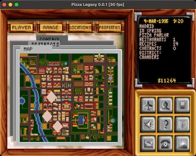

# Pizza Legacy



Pizza Legacy is an open-source reimplementation of the 1994 DOS game
Pizza Tycoon (released as Pizza Connection in Germany). The goal is to
faithfully reimplement the game as a new engine written in modern C++20.
Only the engine is reimplemented, so you will need a copy of the original game
for the assets (graphics, sounds, etc).

Website: [pizzalegacy.nl](https://pizzalegacy.nl)

## Getting the original game

Pizza Legacy requires the asset files from the original DOS version of
Pizza Tycoon / Pizza Connection. The game is available digitally and
frequently goes on sale for under a euro:

- [GOG](https://www.gog.com/en/game/pizza_connection)
- [Steam](https://store.steampowered.com/app/598990/Pizza_Connection/)

If you have a legal copy of the original DOS game on disk, that works too.

Before buying the game specifically for Pizza Legacy, please check the
current status below — the project is playable but
still in alpha and not yet feature-complete.

The original game manual is available online at
[pizzatycoon.org](https://www.pizzatycoon.org/p/manual.html).

### Releases

Prebuilt releases of Pizza Legacy are available on Codeberg:
[https://codeberg.org/cowomaly/pizzalegacy/releases](https://codeberg.org/cowomaly/pizzalegacy/releases)

## Current status

**Alpha.** The core gameplay loop is working: you can open restaurants, hire
staff, design pizzas and compete with computer players. However, expect rough
edges: multiple features are incomplete or completely missing, and crashes may
occur. Development is active.

See [pizzalegacy.nl](https://pizzalegacy.nl) for a detailed status overview.

## Engine features

Pizza Legacy is a new C++20 engine built to reproduce the original game's
behavior, not a reconstruction of the original engine. The reverse engineering
was done through a mix of modifying asset files and observing the effects in
the original game, observing gameplay behavior, and reading the disassembled
DOS executable. The engine itself is designed from scratch.

### Original asset format support

The engine parses the original 1994 asset formats:

- **BOB sprites** (DOS and Amiga bitplane variants) with animation sequences
- **VGA graphics** with indexed-color palettes
- **FNT bitmap fonts**
- **CMF music** (Creative Music Format, OPL3 FM synthesis via libADLMIDI)
- **VOC audio** (Creative Voice Format, decoded and resampled to stereo)
- **Imploder decompression** for Amiga IMP!-compressed assets
- City map data, pizza recipes, restaurant layouts, and character data from
  original formats (DOS version only)

All assets are loaded on demand through a template-based `ResourceManager<T, Loader>`
that caches resources by filename.

### Type-safe coordinate systems

The engine uses phantom types to make coordinate spaces distinct at compile
time. `WorldPoint`, `ViewPoint`, and `ScreenPoint` are separate types that
cannot be accidentally mixed. Camera and viewport transforms convert between
them explicitly. This is zero-cost: the types have the same runtime
representation as their underlying data (e.g. int). The same pattern is used
for IDs (players, restaurants, cities) to prevent mix-ups.

### Rendering pipeline

Rendering uses a layered composition model with per-layer dirty tracking:

- Each view implements a `Renderable` interface with dirty-state tracking
- Layers are cached to SDL surfaces and only recomposed when marked dirty
- 8-bit indexed-color surfaces are expanded to RGBA during composition
- A CRT scaling mode upscales the native 640x400 to 640x480 to approximate
  the original CRT aspect ratio

Screens are managed as a stack, with an overlay system composited on top.
Popups, tooltips, a pause screen, and a debug layer are all independent
overlays that can block or pass through input to the view beneath them.
Screen transitions use palette-based fade-out/fade-in.

### Input system

Input is abstracted into two layers: physical keys (SDL backend) and semantic
actions (game-level). Key bindings support chords (e.g. Ctrl+Shift+B) and are
fully configurable (though not through a UI yet). Listeners register for
actions with priority ordering, and an IME-aware text input mode uses RAII
tokens for safe session management. Continuous axes are computed from input
sources (currently keyboard keys) and normalized to [-1, +1]; the system is
able to incorporate analog sticks but this is not implemented yet.

### Interaction and UI framework

Mouse interaction is based on rectangular hit regions registered with
callbacks, per layer. Events include enter/leave/hover, click, double-click,
and scroll. Registration uses RAII tokens for automatic cleanup. Tooltips,
custom cursors, and exclusive capture modes are built in.

### Audio

The audio system mixes sound effects in real time and plays music through OPL3
FM synthesis. VOC samples are decoded from 8-bit mono to 16-bit stereo
(duplicated channels). Separate volume controls for master, music, and effects,
with gain control.

### Debug console and asset viewers

A built-in debug console accepts commands at runtime for inspecting and
manipulating game state. The engine also ships with dedicated viewer modes for
the original asset formats (sprites, graphics, fonts, palettes, sounds),
launchable via CLI flags, used for helping reverse engineering the original
game's data files.

### Cross-platform

Builds on Linux, macOS, and Windows. SDL2 is confined to the engine layer; game
logic never touches SDL directly. Platform-specific paths (config, saves,
screenshots) are resolved automatically.

### Enhancements

While the goal of the project is a faithful reimplementation, Pizza Legacy
includes several quality-of-life improvements and bug fixes for the original
game. See docs/MODERNIZATIONS.md for a full list of intentional differences.

## Building

### Prerequisites

- CMake 3.25+
- [Ninja](https://ninja-build.org/) build system
- A C++20 compiler: **GCC 13+**, **Clang 17+**, or **MSVC 2022+**.
  GCC 12 works with the `libfmt-dev` library as a fallback for `std::format`. GCC 11 and below are not supported.
- SDL2 (>= 2.0.16)
- libpng (for PNG screenshots)
- libzstd (save file compression)
- [libADLMIDI](https://github.com/Wohlstand/libADLMIDI) for music support
  (optional); you can install it on your system or download the sources and put them in
  `third_party/libadlmidi/` and it wil be picked up during the build
  automatically

Platform-specific setup:

- **Linux (Debian/Ubuntu):** `sudo apt-get install ninja-build libsdl2-dev libpng-dev pkg-config`
- **macOS:** `brew install sdl2 libpng pkg-config ninja`
- **Windows:** Install SDL2 and libpng via `vcpkg`

### Compile

```bash
cmake --preset release
cmake --build --preset release -j
```

If you don't have Ninja, you can build without presets:

```bash
cmake -B build -DCMAKE_BUILD_TYPE=Release
cmake --build build -j
```

### Run

When you launch Pizza Legacy you will be prompted for the original Pizza Tycoon / Pizza Connection
installation directory; point to the directory that contains PT.EXE.

## History

Pizza Legacy has been in development since 2010 as a hobby project. Over
these years the project has gone through several technology migrations,
some of which might have left marks on the code or architecture.

- C++ standard: from pre-C++11 through C++11, C++17, and now C++20
- Build system: from a hand-written Makefile to autotools to CMake
- Graphics: from SDL 1.2 with 8-bit palettes to SDL2 with 32-bit
  surfaces, eventually replacing `SDL_Surface` with a custom Surface class
  and confining SDL to the engine layer
- Pointers: from raw pointers and `auto_ptr` to `shared_ptr`, then
  to `unique_ptr` with raw non-owning pointers

## Contributing

Questions and bug reports are welcome via [Codeberg
Issues](https://codeberg.org/cowomaly/pizzalegacy/issues), though the project
has many known rough edges that will be addressed as core features are
completed. Development currently happens offline and updates are pushed
periodically, so pull requests may not be reviewed immediately. For larger
contributions, it's best to open an issue first to discuss the approach.

## License

Pizza Legacy is licensed under the
[GNU General Public License v3.0](https://www.gnu.org/licenses/gpl-3.0.html).

Third-party libraries are in the `third_party/` directory, each with their
own license. See `docs/CREDITS.md` for details.
