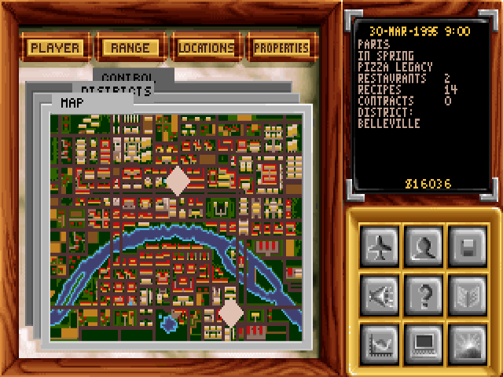
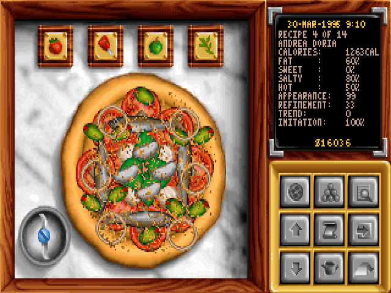

# Pizza Legacy

Pizza Legacy is an open-source reimplementation of the 1994 DOS game
Pizza Tycoon (released as Pizza Connection in Germany). The goal is to
faithfully reimplement the game as a new engine written in modern C++20.
The game itself is fully reimplemented; only the assets (graphics, sounds,
etc.) come from the original, so you will need the original game to play.

Website: [pizzalegacy.nl](https://pizzalegacy.nl)

## Downloads

Prebuilt releases of Pizza Legacy for Windows, macOS, and Linux are available
on Codeberg:
[https://codeberg.org/cowomaly/pizzalegacy/releases](https://codeberg.org/cowomaly/pizzalegacy/releases)

## Getting the original game

Pizza Legacy requires the asset files from the original English-language DOS
version of Pizza Tycoon / Pizza Connection. The game is available digitally and
frequently goes on sale for under a euro:

- [GOG](https://www.gog.com/en/game/pizza_connection)
- [Steam](https://store.steampowered.com/app/598990/Pizza_Connection/)

If you have a legal copy of the original DOS game on disk, that works too.

The original game manual is available online at
[pizzatycoon.org](https://www.pizzatycoon.org/p/manual.html).

## Running the game

On first launch, Pizza Legacy asks you to select the folder containing your
original game files (the folder with `PT.EXE` in it). Steam and GOG
installations are detected automatically: you can point at your Steam or GOG
directory, at `steamapps/common`, or at the Pizza Connection folder itself.

Settings, key bindings, saved games, and screenshots are stored per user:

- **Windows:** `%APPDATA%\nl.pizzalegacy\Pizza Legacy\`
- **macOS:** `~/Library/Application Support/nl.pizzalegacy/Pizza Legacy/`
- **Linux:** `~/.local/share/nl.pizzalegacy/Pizza Legacy/`

Game settings (resolution, volume, autosaves, optional bug fixes, and more)
are changed from the in-game options screen. Keyboard and gamepad bindings can
be customized by editing `bindings.conf` in the directory above; the file is
created on first launch and documents all actions and their default bindings.

## Current status

Pizza Legacy is now feature-complete. Every major gameplay system has been
implemented and the game can be played from start to finish.
Development is currently focused on extensive playtesting, balancing, bug
fixing, and general polish before the next stable release. See
[docs/CHANGELOG.md](docs/CHANGELOG.md) for recent changes.

### Enhancements

While the goal of the project is a faithful reimplementation, Pizza Legacy
includes several quality-of-life improvements and bug fixes for the original
game. See [docs/MODERNIZATIONS.md](docs/MODERNIZATIONS.md) for a full list of
intentional differences.

Some examples:

- Auto-saving, plus a save/load menu showing in-game date, players and city
- Keyboard navigation throughout menus
- Modern mouse support: drag-scrolling and zooming the city map, scroll wheels in lists
- Support for modern displays, including configurable scaling and vsync
- Optional fixes for original bugs, such as the win condition only checking
  Paris instead of all ten cities

## Building

See [docs/BUILDING.md](docs/BUILDING.md) for details.

## Architecture

See [docs/ARCHITECTURE.md](docs/ARCHITECTURE.md) for details about the engine.

## Contributing

Questions and bug reports are welcome via [Codeberg
Issues](https://codeberg.org/cowomaly/pizzalegacy/issues). When reporting a
bug, please include the Pizza Legacy version, your operating system, and what
you expected to happen. If the problem occurs in a running game, attaching a
saved game from the `saves/` directory (see [Running the
game](#running-the-game)) and the steps to reproduce can help a lot.

Development
currently happens offline and updates are pushed periodically, so pull requests
may not be reviewed immediately. For larger contributions, it's best to open an
issue first to discuss the approach.

## License

Pizza Legacy is licensed under the
[GNU General Public License v3.0](https://www.gnu.org/licenses/gpl-3.0.html).

Third-party libraries are in the `third_party/` directory, each with their
own license. See [docs/CREDITS.md](docs/CREDITS.md) for details.
